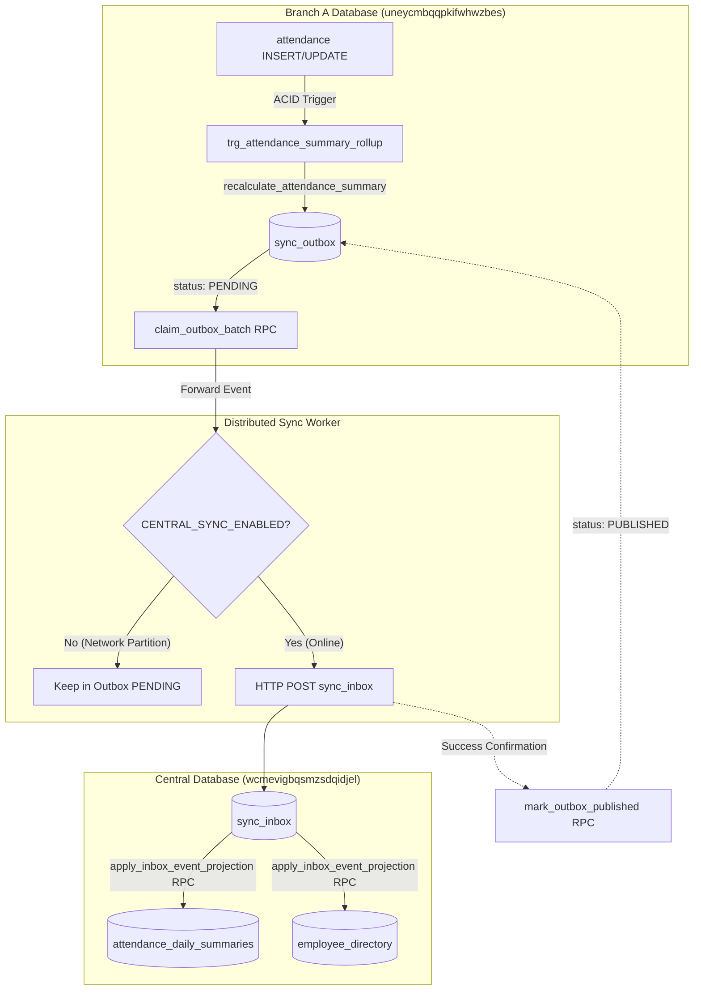

# NEXUS HR — PHASE 4.4 DATABASE INTEGRATION
## Distributed Database Integration & Transactional Outbox Mechanics

**Date:** 2026-11-17  
**Workspace:** `D:\Antigravity_Projects\nexus-hr`  
**Nodes:** `nexus-central` (`wcmevigbqsmzsdqidjel`) & `nexus-branch-a` (`uneycmbqqpkifwhwzbes`)  
**Engine:** PostgreSQL 17.11 (Both Nodes)  

---

## 1. Topological Overview

NEXUS HR uses a multi-node distributed database architecture where each operational branch operates an autonomous PostgreSQL database instance. The Branch database retains complete read/write autonomy for local employee roster operations even during prolonged network partitions from the Central corporate cluster.



---

## 2. Branch A Data Structures & Automation

### 2.1 Operational Master & Roster Tables
- `public.departments`: Master departments (`ENG`, `Teknologi & Rekayasa Sistem`).
- `public.positions`: Master position titles (`ENG-BE-SR`, `Senior Backend Engineer`).
- `public.shifts`: Shift definitions (`REG-PAGI`, 08:00–17:00).
- `public.employees`: Employee identity records bound to departments and positions.
- `public.employee_schedules`: Roster assignments enforcing strictly one active schedule per employee per calendar date (`uq_schedules_emp_date_active`).

### 2.2 Attendance Table (`public.attendance`)
```sql
CREATE TABLE IF NOT EXISTS public.attendance (
    id UUID PRIMARY KEY DEFAULT gen_random_uuid(),
    schedule_id UUID NOT NULL,
    employee_id UUID NOT NULL,
    attendance_date DATE NOT NULL,
    check_in_time TIMESTAMPTZ NOT NULL,
    check_out_time TIMESTAMPTZ,
    status VARCHAR(50) NOT NULL DEFAULT 'ON_TIME',
    check_in_method VARCHAR(50) NOT NULL DEFAULT 'MANUAL_WEB',
    is_verified BOOLEAN NOT NULL DEFAULT FALSE,
    created_at TIMESTAMPTZ NOT NULL DEFAULT now(),
    updated_at TIMESTAMPTZ NOT NULL DEFAULT now(),
    CONSTRAINT uq_attendance_schedule UNIQUE (schedule_id),
    CONSTRAINT fk_attendance_schedule_employee
        FOREIGN KEY (schedule_id, employee_id)
        REFERENCES public.employee_schedules(id, employee_id)
);
```

### 2.3 Transactional Outbox Table (`public.sync_outbox`)
```sql
CREATE TABLE IF NOT EXISTS public.sync_outbox (
    id UUID PRIMARY KEY DEFAULT gen_random_uuid(),
    event_id UUID NOT NULL DEFAULT gen_random_uuid(),
    aggregate_type VARCHAR(100) NOT NULL,
    aggregate_id UUID NOT NULL,
    aggregate_version BIGINT NOT NULL DEFAULT 1,
    event_type VARCHAR(100) NOT NULL,
    payload JSONB NOT NULL,
    status VARCHAR(50) NOT NULL DEFAULT 'PENDING',
    retry_count INT NOT NULL DEFAULT 0,
    next_retry_at TIMESTAMPTZ,
    locked_by VARCHAR(100),
    locked_at TIMESTAMPTZ,
    last_error TEXT,
    created_at TIMESTAMPTZ NOT NULL DEFAULT now(),
    published_at TIMESTAMPTZ,
    CONSTRAINT uq_sync_outbox_event_id UNIQUE (event_id)
);
```

### 2.4 Automatic Trigger Mechanics
When an attendance check-in is inserted:
1. `trg_attendance_summary_rollup` fires `AFTER INSERT OR UPDATE ON public.attendance`.
2. Invokes `public.emit_attendance_summary_outbox_event()`.
3. Calls `public.recalculate_attendance_summary(p_date)` within the same PostgreSQL transaction.
4. Generates a monotonic sequence version:
   `v_rollup_version := (EXTRACT(EPOCH FROM clock_timestamp()) * 1000)::bigint;`
5. Inserts an event row into `public.sync_outbox`:
   - `aggregate_type`: `'ATTENDANCE_SUMMARY'`
   - `aggregate_id`: `'00000000-0000-0000-0000-000000000001'` (Branch A UUID)
   - `aggregate_version`: `v_rollup_version`
   - `event_type`: `'ATTENDANCE_SUMMARY_RECORDED'`
   - `payload`: Total, present, late, absent, and leave counts.
   - `status`: `'PENDING'`

---

## 3. Central Inbound Staging & Materialized Projections

### 3.1 Inbound Staging Table (`public.sync_inbox`)
```sql
CREATE TABLE IF NOT EXISTS public.sync_inbox (
    id UUID PRIMARY KEY DEFAULT gen_random_uuid(),
    event_id UUID NOT NULL,
    source_node VARCHAR(50) NOT NULL,
    aggregate_type VARCHAR(100) NOT NULL,
    aggregate_id UUID NOT NULL,
    aggregate_version BIGINT NOT NULL,
    event_type VARCHAR(100) NOT NULL,
    payload JSONB NOT NULL,
    status VARCHAR(50) NOT NULL DEFAULT 'RECEIVED',
    retry_count INT NOT NULL DEFAULT 0,
    CONSTRAINT uq_sync_inbox_event_id UNIQUE (event_id)
);
```

### 3.2 Materialized Summary Table (`public.attendance_daily_summaries`)
```sql
CREATE TABLE IF NOT EXISTS public.attendance_daily_summaries (
    id UUID PRIMARY KEY DEFAULT gen_random_uuid(),
    branch_id UUID NOT NULL REFERENCES public.branches(id) ON DELETE RESTRICT,
    summary_date DATE NOT NULL,
    total_employees INT NOT NULL DEFAULT 0,
    present_count INT NOT NULL DEFAULT 0,
    late_count INT NOT NULL DEFAULT 0,
    absent_count INT NOT NULL DEFAULT 0,
    leave_count INT NOT NULL DEFAULT 0,
    source_version BIGINT NOT NULL DEFAULT 1,
    last_synced_at TIMESTAMPTZ NOT NULL DEFAULT now(),
    CONSTRAINT uq_daily_summary_branch_date UNIQUE (branch_id, summary_date)
);
```

### 3.3 Monotonic Projection Logic (`apply_inbox_event_projection`)
When `public.apply_inbox_event_projection(p_event_id)` executes:
1. Early exit: If status is already `'PROCESSED'`, immediately returns `TRUE` (idempotent no-op).
2. For `ATTENDANCE_SUMMARY_RECORDED`:
   ```sql
   INSERT INTO public.attendance_daily_summaries (
       branch_id, summary_date, total_employees, present_count,
       late_count, absent_count, leave_count, last_synced_at, source_version
   ) VALUES (...)
   ON CONFLICT (branch_id, summary_date) DO UPDATE
   SET total_employees = EXCLUDED.total_employees,
       present_count = EXCLUDED.present_count,
       late_count = EXCLUDED.late_count,
       absent_count = EXCLUDED.absent_count,
       leave_count = EXCLUDED.leave_count,
       last_synced_at = now(),
       source_version = EXCLUDED.source_version,
       updated_at = now()
   WHERE EXCLUDED.source_version > public.attendance_daily_summaries.source_version;
   ```
3. The clause `WHERE EXCLUDED.source_version > public.attendance_daily_summaries.source_version` guarantees that stale or out-of-order network replays cannot overwrite newer rollups.
4. Updates `public.sync_inbox` status to `'PROCESSED'`.

---

## 4. Live Verification Data

### Branch A Outbox Audit (`uneycmbqqpkifwhwzbes`)
```sql
SELECT status, count(*) FROM public.sync_outbox GROUP BY status;
```
Result:
| Status | Row Count |
| :--- | :--- |
| `PUBLISHED` | 6 |
| `PENDING` | 0 |
| `PROCESSING` | 0 |
| `FAILED` | 0 |

### Central Projections Audit (`wcmevigbqsmzsdqidjel`)
```sql
SELECT branch_id, summary_date, total_employees, present_count, late_count, absent_count, source_version 
FROM public.attendance_daily_summaries;
```
Result:
| branch_id | summary_date | total_employees | present_count | late_count | absent_count | source_version |
| :--- | :--- | :--- | :--- | :--- | :--- | :--- |
| `00000000-0000-0000-0000-000000000001` | `2026-11-17` | 2 | 0 | 2 | 0 | 1794898923735 |

Central `public.employee_directory`:
| employee_code | full_name | department_name | position_title | version |
| :--- | :--- | :--- | :--- | :--- |
| `EMP-A-0002` | Budi Santoso | Teknologi & Rekayasa Sistem | Senior Backend Engineer | 1 |
| `EMP-A-0003` | Siti Rahmawati | Teknologi & Rekayasa Sistem | Senior Backend Engineer | 1 |

All projections reflect 100% data consistency between Branch A and Central.
