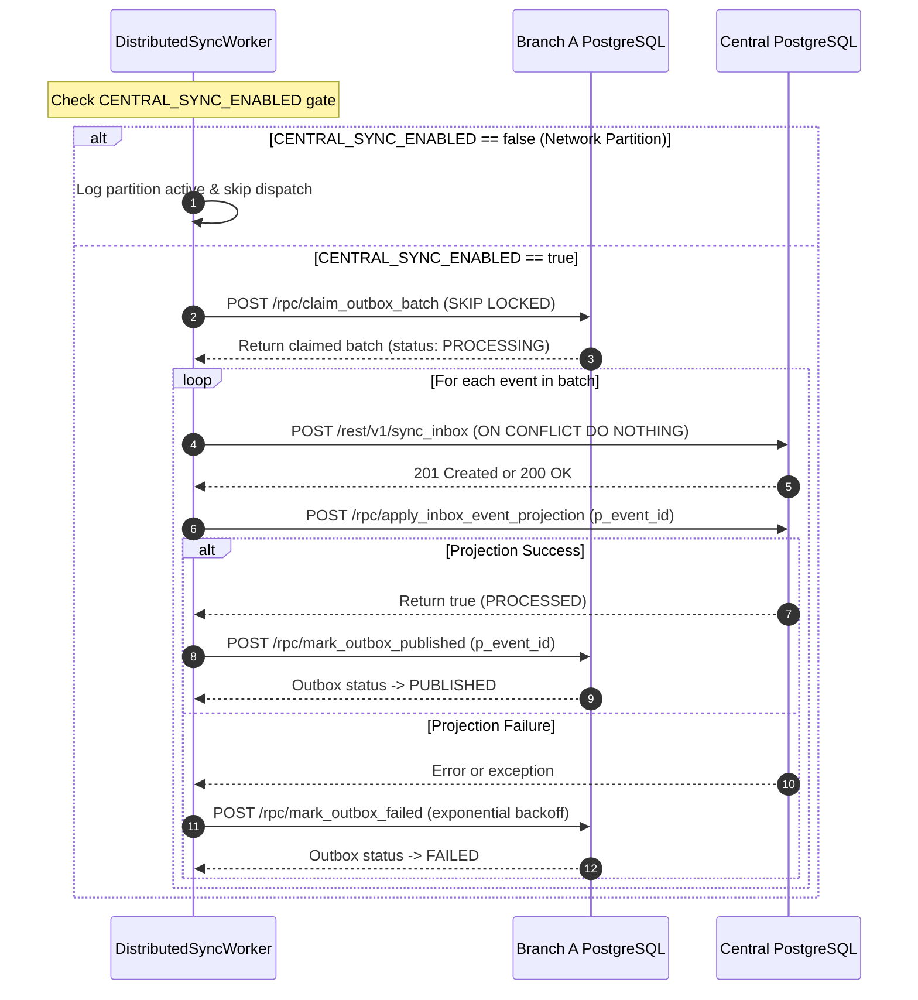

# NEXUS HR — PHASE 4.4 SYNC WORKER REPORT
## Distributed Sync Worker Architecture, Relay Mechanics & Verification

**Date:** 2026-11-17  
**Component:** `gateway/src/sync/sync-worker.ts`  
**CLI Runner:** `gateway/src/sync/run-sync.ts`  
**Test Suite:** `gateway/src/__tests__/sync-worker.test.ts` (44/44 PASS)  

---

## 1. System Role & Architecture

The `DistributedSyncWorker` is an autonomous background synchronization process operating alongside the Backend API Gateway. It bridges Branch A's transactional outbox with Central's inbound staging inbox, implementing the **Transactional Outbox Pattern** with **At-Least-Once Delivery** and **Idempotent Consumer Processing**.



---

## 2. Technical Specifications

### 2.1 Configuration Parameters (`SyncWorkerConfig`)
| Parameter | Type | Default | Description |
| :--- | :--- | :--- | :--- |
| `branchASupabaseUrl` | `string` | *(Required)* | Branch A Supabase REST endpoint |
| `branchAServiceRoleKey` | `string` | *(Required)* | Branch A service role key |
| `centralSupabaseUrl` | `string` | *(Required)* | Central Supabase REST endpoint |
| `centralServiceRoleKey` | `string` | *(Required)* | Central service role key |
| `workerId` | `string` | `'worker-branch-a-1'` | Identifier for row leasing |
| `batchSize` | `number` | `10` | Maximum events claimed per cycle |
| `syncEnabled` | `boolean` | `process.env.CENTRAL_SYNC_ENABLED !== 'false'` | Network partition toggle |
| `requestTimeoutMs` | `number` | `5000` | HTTP abort timeout for node calls |

### 2.2 Core Operational Methods

#### `runSyncCycle(): Promise<SyncCycleResult>`
Executes a single end-to-end sync iteration:
1. **Partition Gate:** If `!this.syncEnabled`, logs `sync.partition.active` and immediately halts before querying Central.
2. **Lease Claim:** Calls Branch A RPC `claim_outbox_batch(p_worker_id, p_batch_size)`. Utilizes `FOR UPDATE SKIP LOCKED` in PostgreSQL to allow safe multi-worker scaling without lease contention.
3. **Sequential Relay:** Iterates over claimed rows:
   - Forwards to Central `public.sync_inbox` with header `Prefer: resolution=ignore-duplicates`.
   - Executes Central RPC `public.apply_inbox_event_projection(p_event_id)`.
   - On success, confirms delivery via Branch A RPC `public.mark_outbox_published(p_event_id, p_worker_id)`.
   - On failure, registers failure via Branch A RPC `public.mark_outbox_failed(p_event_id, p_worker_id, p_error_message)`.

#### `getOutboxStatus(): Promise<OutboxStatusSummary>`
Aggregates Branch A outbox metrics by status (`PENDING`, `PROCESSING`, `PUBLISHED`, `FAILED`).

#### `getInboxStatus(): Promise<InboxStatusSummary>`
Aggregates Central inbox metrics by status (`RECEIVED`, `PROCESSING`, `PROCESSED`, `FAILED`, `DEAD_LETTER`).

---

## 3. CLI Runner Scripts

Integrated into `gateway/package.json`:
- **`npm run sync`:** Executes a single claim-and-forward batch and exits.
- **`npm run sync:watch`:** Polls Branch A every 5,000ms in an ongoing loop.
- **`npm run sync:partition`:** Runs a cycle with `CENTRAL_SYNC_ENABLED=false` to demonstrate safe outbox buffering during simulated network outage.

---

## 4. Test Suite Verification

Comprehensive unit and wire tests are implemented in `gateway/src/__tests__/sync-worker.test.ts`.

```
▶ DistributedSyncWorker Unit & Contract Tests
  ✔ skips claiming and dispatch when CENTRAL_SYNC_ENABLED=false (network partition) (7.38ms)
  ✔ claims batch from Branch A and delivers to Central, marking published on success (100.64ms)
  ✔ marks outbox as failed with error backoff when Central projection fails (7.90ms)
  ✔ aggregates outbox status counts correctly (3.86ms)
✔ DistributedSyncWorker Unit & Contract Tests (123.66ms)
```

Combined with existing Gateway tests, the test suite achieves **44 passing tests out of 44** with 0 failures:
- CentralJwtVerifier: 7 tests PASS
- loadGatewayConfig: 7 tests PASS
- ActorHmacSigner & NonceStore: 4 tests PASS
- HTTP Clients Wire-Level: 4 tests PASS
- IdentityResolver: 5 tests PASS
- Gateway HTTP & LeaveService: 5 tests PASS
- Gateway Read Endpoints: 2 tests PASS
- SEC-41 Remediation: 6 tests PASS
- DistributedSyncWorker: 4 tests PASS
